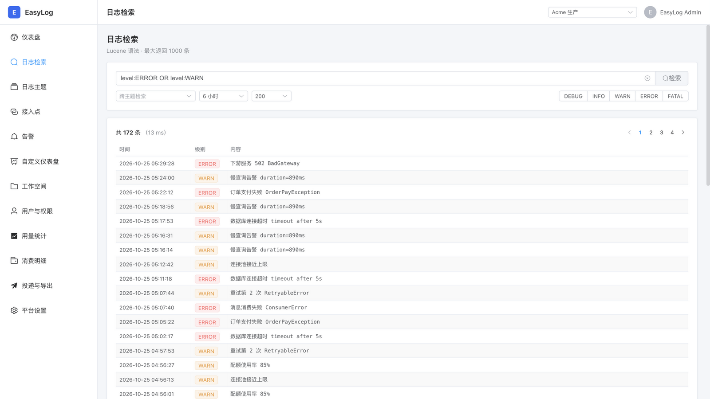
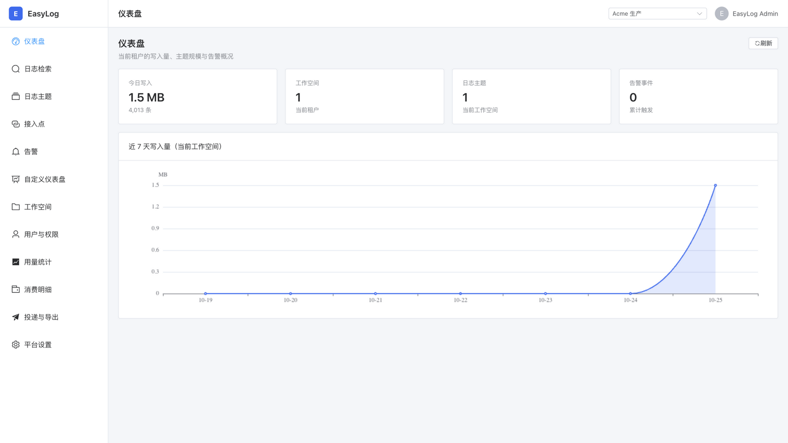
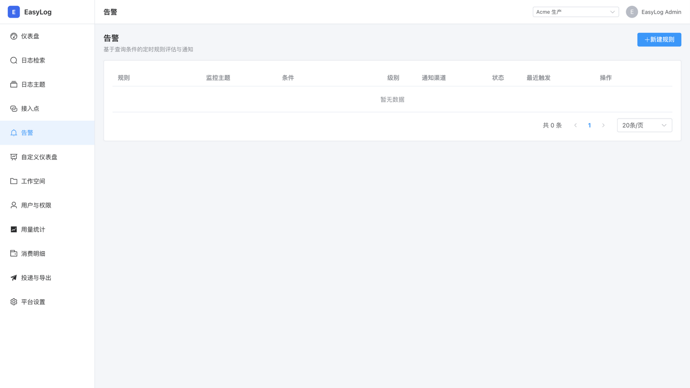
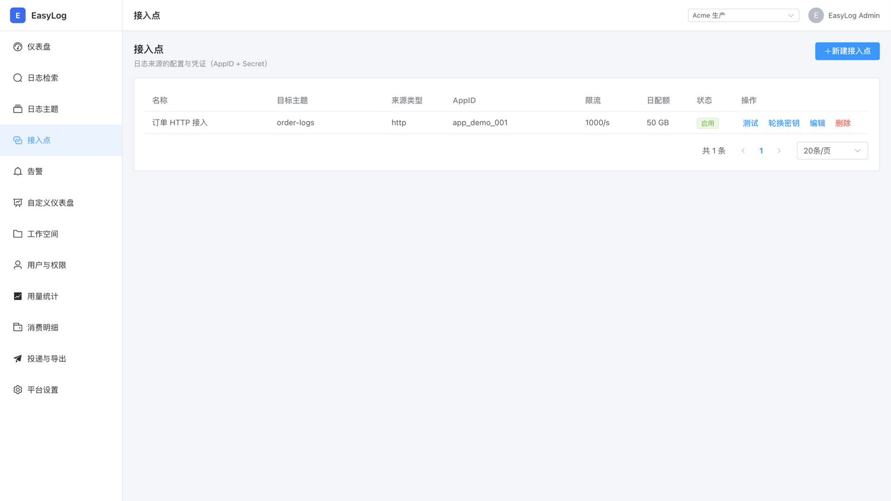

# EasyLog

[English](README.md) | 简体中文

[](https://github.com/dunhao/EasyLog/actions/workflows/ci.yml)
[](LICENSE)
[](https://www.php.net/)

一个 PHP 友好的开源多租户 SaaS 日志服务平台：**从 2 容器零依赖单机起步，按配置升级到 ES + Kafka 完整链路**。

- 三档按需启动：默认 lite（2 容器、SQLite、零外部依赖，内存 ~300MB），core / full 按配置升级
- 一套部署，多项目/客户独立使用（工作空间隔离 / RBAC / 配额 / 审计）
- 支持 HTTP API / SDK（php·go·java）/ 文件采集 Agent / Kafka / RabbitMQ / Redis / ActiveMQ 多种接入
- 集成 Elasticsearch / OpenObserve / Quickwit / SQLite 四存储后端（可切换）
- Lucene 子集 + SQL 子集检索、直方图、聚合、告警（webhook/邮件，含 σ 异常检测）
- 参考 腾讯云 CLS / 阿里云 SLS 功能集

## 控制台截图

| 日志检索（Lucene 语法） | 仪表盘 |
|:---:|:---:|
|  |  |

| 告警规则（含 σ 异常检测） | 接入点 |
|:---:|:---:|
|  |  |

## 快速开始

### 1. lite 档（默认，2 容器零依赖）

```bash
cd deploy/compose && ./start.sh
```

只起 app + frontend 两个容器：元数据与日志都存 SQLite（卷持久化）、direct 直写总线、
file 缓存 —— 不需要 MySQL / Redis / ES / Kafka。控制台与接入 API 同端口（9515），
搜索/直方图/聚合/Lucene 子集/SQL 子集全部可用。默认账号 `admin@easylog.local` / `easylog@2026`。

首条日志：

```bash
curl -X POST http://localhost:9515/api/v1/ingest \
  -H 'X-EasyLog-App: app_demo_001' -H 'Authorization: Bearer sec_demo_001' \
  -H 'Content-Type: application/json' \
  -d '{"msg":"hello easylog","level":"ERROR","service":"order-api"}'
```

### 2. core / full 档（全家桶，按需）

```bash
cd deploy/compose && ./start.sh core    # +redis/es/zk/kafka + 5 应用角色（需宿主机 MySQL）
cd deploy/compose && ./start.sh full    # core + rabbitmq + worker（外部 MQ 消费 + 命令行告警巡检）
```

core 档端口：控制台 9516，Ingestion 9514，Admin 9515，Query 9517，MySQL 3306（宿主机），
Redis 6379，Kafka 9092/29092，ES 9200；full 档另有 RabbitMQ 5672/15672。

> 三档互斥（9515 端口冲突），切档先 `./start.sh stop`；lite 与 core 是场景选择，数据不自动迁移。

### 3. 本地开发（不使用 Docker）

详见 [docs/04-usage-guide.md](docs/04-usage-guide.md)

## 业务项目如何接入

三档共用同一套 HTTP 接入 API（lite 档 `http://<host>:9515`，core/full 档独立网关
`http://<host>:9514`），接入方式任选：

**方式一：日志文件采集（免改代码，推荐存量项目）** —— 把 `sdk/agent/` 的单文件
采集器放到目标机器，配置项目日志目录（如 ThinkPHP `runtime/log/`、Laravel
`storage/logs/`），常驻运行即可自动 tail → 解析（thinkphp/laravel/json/regex/plain，
多行堆栈合并）→ 批量推送。断点续采、轮转自适应、支持 cron 单轮模式：

```bash
php easylog-agent test  -c easylog-agent.json   # 干跑验证解析
php easylog-agent start -c easylog-agent.json   # 常驻采集（--once 走 cron）
```

详见 [sdk/agent/README.md](sdk/agent/README.md)。

**方式二：代码内集成（实时性最好）** —— `sdk/php`（Monolog Handler）、`sdk/go`
（slog）、`sdk/java`（Logback Appender）直接在应用里推日志。

**方式三：外部 MQ 拉取（full 档）** —— Kafka / RabbitMQ / Redis Stream / ActiveMQ。

接入凭据（AppID/AppSecret）在控制台"工作空间 → 接入点"创建。

## 实测性能（lite 档）

测试脚本入库可复现：`php scripts/benchmark-ingest.php`：

| 指标 | 结果 | 环境 |
|---|---|---|
| 写入吞吐 | **~1,200 条/秒**（4 并发 × 200/批，0 失败） | Apple Silicon 笔记本，单容器 |
| 过滤检索 | **~30ms**（字段过滤命中 3,200 条取 200 条） | SQLite WAL |
| 容器内存 | **~300MB** | 2 个 Octane worker |

core 档接入/检索/写入分角色部署、ES 存储，可水平扩展。

## 项目结构

```
log-service/
├── docs/                       设计文档（架构/详设/部署/使用）
├── services/admin/             Laravel 12 应用主体（按 SERVICE_ROLE 裂变为 5 角色）
├── sdk/                        php / go / java SDK + agent 文件采集器
├── frontend/                   Vue3 + Vite + Element Plus + ECharts 控制台（14 页面）
├── deploy/                     compose 三档编排 / 镜像 / k8s 清单
└── scripts/                    基准测试等工具
```

## 文档导航

- [总体架构设计](docs/01-architecture.md) · [详细设计](docs/02-detailed-design.md) · [使用说明](docs/04-usage-guide.md) · [部署指南](docs/05-deployment-guide.md)
- SDK：[agent 采集器](sdk/agent/README.md) · [php](sdk/php) · [go](sdk/go) · [java](sdk/java)

## 技术栈

- **后端**: PHP 8.3 运行时（源码兼容 ≥8.2）+ Laravel 12 + Swoole 5 (Octane)
- **存储**: Elasticsearch 8 / OpenObserve / Quickwit / SQLite（lite 档，可切换）
- **消息**: Kafka 3.7（core/full 档；lite 档直写免中间件）
- **元数据**: MySQL 8 + Redis 7（lite 档 SQLite + file 缓存零依赖）
- **前端**: Vue 3.4 + Vite 5 + Element Plus + ECharts

## 路线图

- v1.0: 完整告警 + 投递 + 消费组 API + 计量 + SDK 三语言（✅ 已发布）
- v1.x: 文件采集 Agent（✅）、syslog 接入、更多存储后端
- v2.0: Kafka Wire Protocol 对外暴露

## 贡献

欢迎 Issue / PR，参与方式见 [CONTRIBUTING.md](CONTRIBUTING.md)；安全问题请私下报告（[SECURITY.md](SECURITY.md)）。

## License

Apache-2.0，详见 [LICENSE](LICENSE)。
